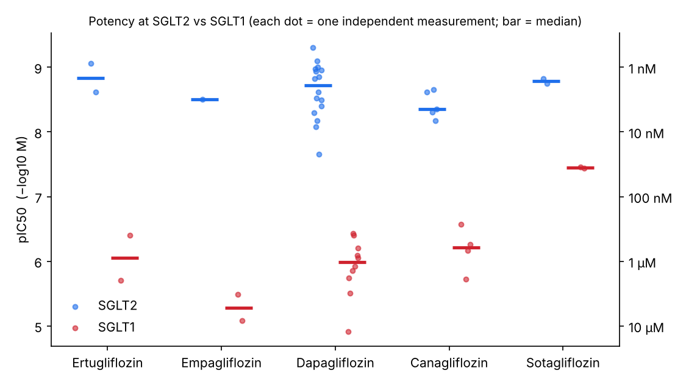
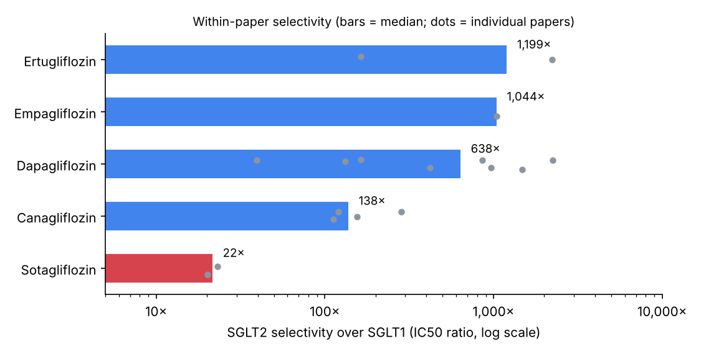

# Cardiometabolic Drug-Target Explorer: SGLT2 Inhibitor Selectivity from ChEMBL


A small, reproducible pharmacology analysis built on **ChEMBL** bioactivity data. It looks at how potent and how
selective the five SGLT2 inhibitors tested in cardiovascular and kidney outcome trials are for **SGLT2** (kidney
glucose reabsorption) relative to **SGLT1** (intestinal glucose absorption).

It is the molecular companion to
[**sglt2-inhibitor-meta-analysis**](https://github.com/alirezajavan-sys/sglt2-inhibitor-meta-analysis), which pools
the clinical outcome trials of the same drugs. It also complements my
[**cardiovascular-in-silico-platform**](https://github.com/alirezajavan-sys/cardiovascular-in-silico-platform).

## Question

> Are "SGLT2 inhibitors" a pharmacologically homogeneous class? Specifically, is sotagliflozin, which was used in
> SCORED and SOLOIST-WHF, a different kind of molecule from the other gliflozins?

## Data

| | |
|---|---|
| Source | ChEMBL (EMBL-EBI), retrieved November 2026 |
| Targets | Human SGLT2 (`CHEMBL3884`, *SLC5A2*) and SGLT1 (`CHEMBL4979`, *SLC5A1*) |
| Drugs | dapagliflozin, empagliflozin, canagliflozin, ertugliflozin, sotagliflozin |
| Measurements | IC50 with "=" relation in nM: 101 records, **46 independent** after de-duplication |

[`data/chembl_sglt_ic50_snapshot.csv`](data/chembl_sglt_ic50_snapshot.csv) keeps the ChEMBL `activity_id`,
`assay_chembl_id` and `document_chembl_id` for every value, so each number can be traced to its source publication.
Running `python scripts/fetch_chembl.py` rebuilds the snapshot from the live ChEMBL API.

**De-duplication matters.** ChEMBL often re-records a reference compound's IC50 each time a later paper cites it. These
are flagged `potential_duplicate`. Counting them would over-weight a few original measurements, so they are removed,
along with exact re-depositions of the same record.

## Methods

* Potency is expressed as pIC50 = −log10(IC50 in M). The median is taken over independent measurements.
* Selectivity is IC50(SGLT1) / IC50(SGLT2), estimated two ways:
  * **paired (preferred):** the ratio is computed *within* each publication that measured both transporters under
    identical conditions, then the median is taken across publications. This cancels between-laboratory offsets;
  * **pooled:** the ratio of the per-target medians across all publications.

## Results

| Drug | SGLT2 IC50 | SGLT1 IC50 | Selectivity (paired) | Outcome trials |
|---|---|---|---|---|
| Ertugliflozin | 1.5 nM | 877 nM | **~1,200×** | VERTIS CV |
| Empagliflozin | 3.1 nM | 5,182 nM | **~1,040×** | EMPA-REG, EMPEROR-Reduced/Preserved, EMPA-KIDNEY |
| Dapagliflozin | 1.9 nM | 1,031 nM | **~640×** | DECLARE, DAPA-HF, DAPA-CKD, DELIVER |
| Canagliflozin | 4.4 nM | 613 nM | **~140×** | CANVAS, CREDENCE |
| Sotagliflozin | 1.6 nM | 35 nM | **~22×** | SCORED, SOLOIST-WHF |

<p align="center">
  
  
</p>

### Interpretation

* **All five drugs are equally potent at SGLT2** (IC50 1–5 nM). They differ almost entirely in how much they spare
  SGLT1.
* **Sotagliflozin is a dual SGLT1/2 inhibitor.** It has nanomolar SGLT1 potency and only about 20-fold selectivity,
  far below the other four. SGLT1 inhibition in the gut delays glucose absorption, which fits its higher reported
  rate of diarrhoea.
* **Canagliflozin sits in between** (about 140-fold). Partial intestinal SGLT1 inhibition at its 300 mg dose has been
  proposed to contribute to its post-prandial glucose effect.
* **Clinically, the heart-failure benefit appears regardless.** In the companion meta-analysis, excluding the
  sotagliflozin trials leaves the pooled HR unchanged (0.78). The cardio-renal benefit therefore tracks SGLT2
  inhibition, not SGLT1 sparing.
* **Measurement variability is large.** Dapagliflozin's within-paper selectivity ranges from 39× to 2,250× across
  eight publications. Single literature values for selectivity should be quoted with caution.

## Limitations

* Small n for some drug–target pairs (e.g. one independent SGLT2 value for empagliflozin) after strict
  de-duplication.
* IC50s come from heterogeneous cell-based uptake assays (different cell lines, substrates and incubation times).
  The paired estimator mitigates, but does not remove, this.
* In-vitro selectivity does not translate directly to in-vivo target engagement, which also depends on exposure
  (e.g. intestinal luminal concentration for SGLT1).

## Reproduce

```bash
git clone https://github.com/alirezajavan-sys/cardio-drug-target-explorer.git
cd cardio-drug-target-explorer
pip install -r requirements.txt
python run_analysis.py            # tables + figures from the committed snapshot
python scripts/fetch_chembl.py    # optional: refresh the snapshot from ChEMBL
pytest
```

## Repository structure

```
├── data/chembl_sglt_ic50_snapshot.csv   # 101 ChEMBL records with activity/assay/document IDs
├── scripts/fetch_chembl.py              # rebuild the snapshot from the ChEMBL REST API
├── src/cardiotarget/selectivity.py      # de-duplication, pooled and paired selectivity
├── run_analysis.py                      # tables and figures
├── results/  figures/
└── tests/                               # pChEMBL consistency check, de-duplication, maths, pharmacology sanity check
```

## References

* Zdrazil B, et al. The ChEMBL Database in 2023: a drug discovery platform spanning multiple bioactivity data types
  and time periods. *Nucleic Acids Res.* 2024;52(D1):D1180–D1192.
* Primary trial publications are listed in the companion
  [meta-analysis repository](https://github.com/alirezajavan-sys/sglt2-inhibitor-meta-analysis).

ChEMBL data are available under a CC BY-SA 3.0 licence.

## Author

**Alireza Javan**. [GitHub profile](https://github.com/alirezajavan-sys)
